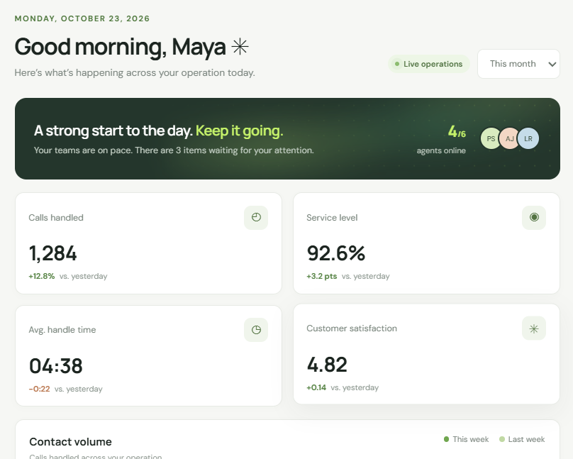
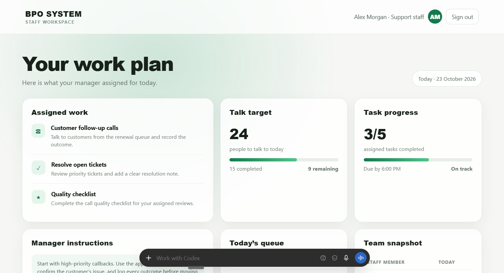

# BPO SYSTEM

Local BPO operations dashboard with an admin workspace, staff workspace, task controls, period-based overview metrics, and staff data exports.

## Screenshots

### Admin overview



### Staff workspace



## Run locally

Requirements: Node.js 18 or newer.

```powershell
node local-server.mjs
```

Open:

- Admin dashboard: http://127.0.0.1:3000/
- Staff workspace: http://127.0.0.1:3000/staff.html
- Staff sign in: http://127.0.0.1:3000/login

The project is a browser-based static frontend. Dashboard state is stored in browser local storage. The MongoDB connection panel is included as a UI placeholder for a future server-side database API.
