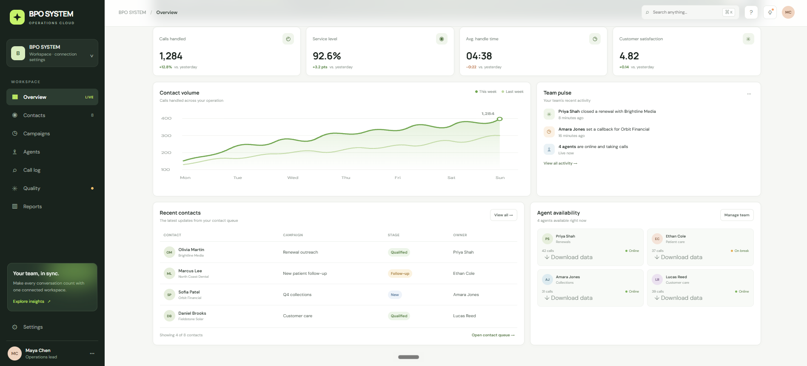

# BPO SYSTEM

Local BPO operations dashboard with an admin workspace, staff workspace, task controls, period-based overview metrics, and staff data exports.

## Screenshots

### Admin overview



### Staff workspace


Open the [staff workspace locally](http://127.0.0.1:3000/staff.html) to use the live task controls.

## Run locally

Requirements: Node.js 18 or newer.

```powershell
node local-server.mjs
```

Open:

- Admin dashboard: http://127.0.0.1:3000/
- Staff workspace: http://127.0.0.1:3000/staff.html
- Staff sign in: http://127.0.0.1:3000/login

The project is a browser-based static frontend. Dashboard state is stored in browser local storage. The MongoDB connection panel is included as a UI placeholder for a future server-side database API.

## MongoDB database

Use MongoDB Atlas as the persistent database for BPO data. Configure the Atlas connection in Vercel as a server-side environment variable:

```text
MONGODB_URI=mongodb+srv://<atlas-user>:<atlas-password>@<atlas-cluster>/bpo_system
```

Store staff profiles, approval status, assignments, calls, tickets, attendance, billing, SLA records, complaints, recruitment records, and performance data in MongoDB collections. A server-side API should read and write these collections; browser local storage is only a temporary fallback for the static demo.

## Excel exports

The admin overview includes **Download data** on each staff member card. It downloads an Excel-compatible `.xls` file containing the staff profile and assigned data counts. The export includes calls, contacts, and campaigns for that staff member. The completion percentage is shown in the staff workspace task progress card (for example, `3/5` tasks completed and `60%`); the Excel file contains the underlying counts so the same percentage can be calculated in a spreadsheet.

Staff pages are protected by the sign-in session. Opening `/staff.html` directly redirects to `/login` until the staff member submits the login form.

Never put the real Atlas URI, username, or password in the frontend or commit it to GitHub. The repository contains only the safe placeholder above.
